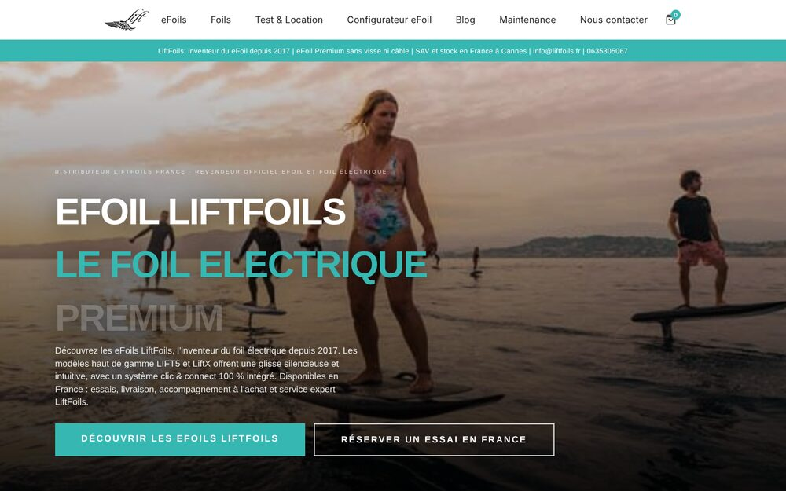
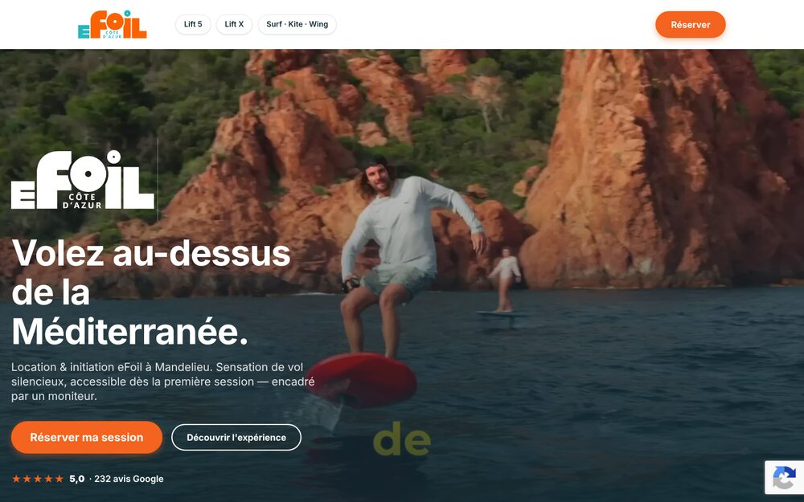

  

  
  
  

---

Je construis des **sites et des outils métier qui tournent en production**, pour des PME qui vendent vraiment quelque chose : e-commerce, réservation, SAV, suivi logistique. Mon angle n'est pas de livrer une maquette — c'est de livrer un truc qui encaisse des commandes le lundi matin.

Depuis 2024, j'ajoute une couche **automatisation IA** : bots WhatsApp connectés à l'ERP, tri et rédaction d'e-mails SAV, assistants internes branchés sur les vraies données du client. Et je garde un pied côté **sécurité et infra** — certifs ANSSI SecNumAcadémie, Cisco Réseaux, RGPD — parce qu'un site qui vend est aussi un site qu'on attaque.

 

### 🧰 Stack

  
   
  
   
  

<table align="center">
<tr>
<td align="center" width="33%">

**🛒 E-commerce & sites**

WordPress / WooCommerce,
Next.js, refontes,
performance & SEO

</td>
<td align="center" width="33%">

**🤖 Automatisation & IA**

Bots WhatsApp, n8n,
intégrations Odoo,
tri d'e-mails, agents

</td>
<td align="center" width="33%">

**🛡️ Sécurité & infra**

VPS auto-hébergés, Docker,
Coolify, durcissement,
RGPD, OSINT

</td>
</tr>
</table>

 

## 📌 Projets en vedette

<table>
<tr>
<td width="50%" valign="top">

### 🛥️ Lift Foils France

**Le problème** — Un distributeur officiel d'eFoils haut de gamme qui vend des produits à plusieurs milliers d'euros, avec un catalogue technique difficile à faire comprendre en ligne.

**Ce que j'ai fait** — Boutique WordPress / WooCommerce, configurateur eFoil sur mesure, tunnel de réservation d'essai, blog et SEO.

`WordPress` `WooCommerce` `PHP` `JS`

**Statut** — 🟢 en production sur [liftfoils.fr](https://liftfoils.fr)

</td>
<td width="50%" valign="top">

### 🌊 eFoil Côte d'Azur

**Le problème** — Une base de location et d'initiation eFoil à Mandelieu dont les réservations partaient en appels et en messages, sans parcours en ligne clair.

**Ce que j'ai fait** — Refonte complète du site, mise en avant de l'expérience client, parcours de réservation et preuve sociale (5,0 ★ sur 232 avis Google).

`WordPress` `PHP` `Tailwind` `SEO`

**Statut** — 🟢 en production sur [efoilcotedazur.fr](https://efoilcotedazur.fr)

</td>
</tr>
<tr>
<td width="50%" valign="top">

### 📡 TrackShip

**Le problème** — Repérer l'arrivée d'un navire sur une zone précise, sans rester à surveiller une carte toute la journée.

**Ce que j'ai fait** — Une app mobile qui notifie dès qu'un navire entre dans un rayon de 3 km. Backend Node.js / Express qui interroge l'API **EuRIS** (le service européen d'information fluviale) via un *cron* — une tâche planifiée qui tourne toute seule — calcule les distances en Haversine (formule de distance entre deux points du globe) et pousse des notifications Expo.

`Node.js` `Express` `Expo` `Firebase` `Railway`

→ [`trackship-backend`](https://github.com/GHOSTGIT-cyber/trackship-backend) · [`trackship-mobile`](https://github.com/GHOSTGIT-cyber/trackship-mobile)

</td>
<td width="50%" valign="top">

### ⚙️ Configurateur eFoil

**Le problème** — Un client qui doit choisir entre des dizaines de combinaisons board / aile / mât abandonne avant de demander un devis.

**Ce que j'ai fait** — Un configurateur pas à pas qui guide le choix, affiche le prix en direct et envoie une demande de devis qualifiée, avec réponse automatique derrière.

`JavaScript` `WooCommerce` `n8n`

→ [`Configurateur`](https://github.com/GHOSTGIT-cyber/Configurateur)

</td>
</tr>
</table>

 

## 🎓 Formation & certifications

| Diplôme / certification | Année |
|---|:---:|
| 🎓 **BTS SIO** option SLAM — *Solutions Logicielles et Applications Métiers* | 2024 |
| 🛡️ **SecNumAcadémie** — ANSSI, agence nationale de la sécurité des systèmes d'information | — |
| 🌐 **Cisco** — Réseaux | — |
| 📋 **RGPD** — protection des données personnelles | — |

 

## 💼 Me contacter

Je prends des missions en freelance : **création et refonte de sites**, **e-commerce**, **automatisation et agents IA**, **maintenance et infogérance**.

  
  

  Missions à distance partout en France

